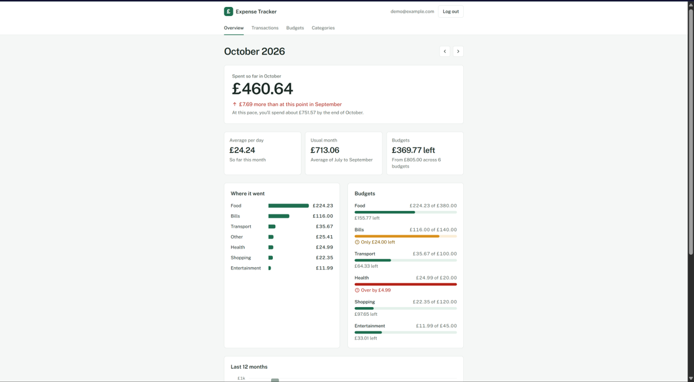
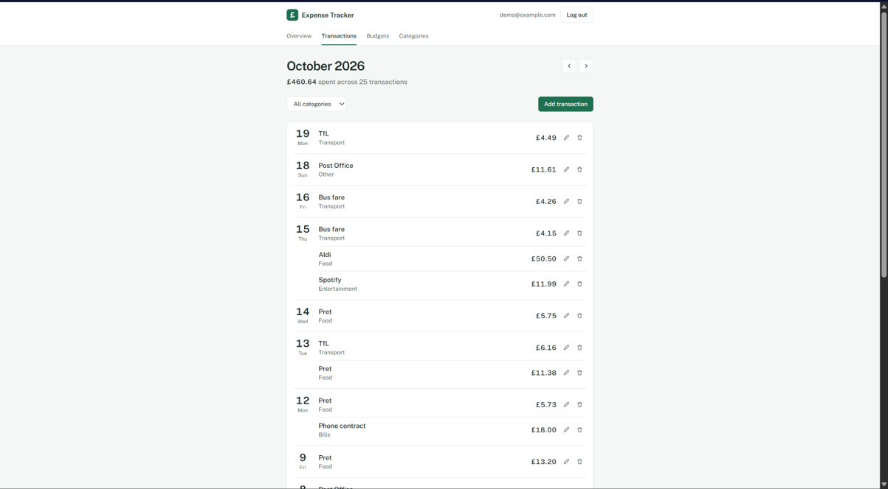
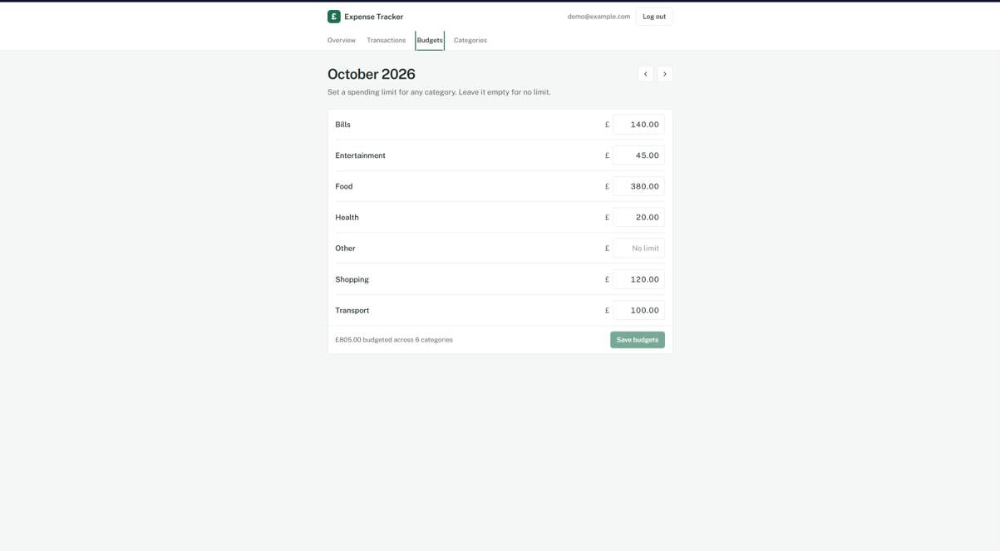
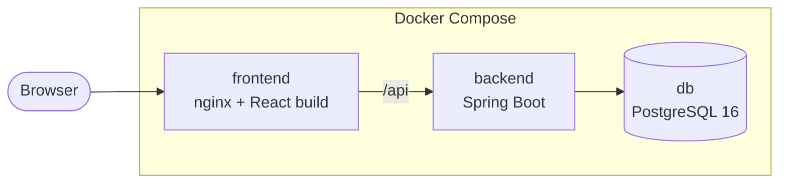

# Expense & Budget Tracker

[](https://github.com/MZain06/Expense-and-Budget-Tracker/actions/workflows/ci.yml)
[](LICENSE)

Track your spending against a monthly budget for each category, and see where the month is heading. The backend is Java 21 and Spring Boot 4 on PostgreSQL, the frontend is React 19 and TypeScript, and the whole app runs with one Docker Compose command.

<p align="center">
  
</p>

## Features

- **Overview:** spending so far compared with the same point last month, a month-end projection, spending by category, a meter for each budget, a 12-month trend and the biggest changes since last month.
- **Transactions:** add, edit and delete them, filtered by month and category.
- **Budgets:** a monthly limit for any category, and last month's limits copied in one click.
- **Categories:** seven to start with. Add, rename or delete them; a category that's in use can't be deleted.
- **Accounts:** sign up and sign in. Each user only ever sees their own data.

<p>
  
  
</p>

## Quick start

You need [Docker Desktop](https://www.docker.com/products/docker-desktop/), or Docker Engine with Compose.

```bash
git clone https://github.com/MZain06/Expense-and-Budget-Tracker.git
cd Expense-and-Budget-Tracker
cp .env.example .env
```

In `.env`, set `JWT_SECRET` to a random string of at least 32 characters (`openssl rand -base64 48` makes one). Then:

```bash
docker compose up --build --wait
```

Open http://localhost:3000 and sign in as `demo@example.com` with the password `demo-password`. The demo account is reset to a year of sample spending each time the backend starts.

## How it works



- **One origin.** nginx serves the React app and passes `/api` requests to Spring Boot, so the browser never talks to the backend directly and there's no CORS to configure.
- **Stateless auth.** Signing in returns a JWT (HS256, valid for an hour). Passwords are hashed with BCrypt, and the signing secret comes from the environment.
- **Data isolation.** Every query is scoped to the signed-in user. Asking for someone else's transaction returns 404, so IDs can't be probed.
- **Exact money.** Amounts are `NUMERIC(12, 2)` in Postgres and `BigDecimal` in Java, and the frontend adds them up in whole pence.
- **Fair comparisons.** Partway through a month, "last month" means the same days of last month, so a half month is never compared with a whole one.
- **Migrations.** Flyway owns the schema, and Hibernate only checks that the entities match it.
- **Locked-down containers.** Non-root users, read-only filesystems, no Linux capabilities, ports bound to localhost, and a strict Content-Security-Policy from nginx.

## Tech stack

| Area | Tools |
| --- | --- |
| Backend | Java 21, Spring Boot 4.1 (Web MVC, Data JPA, Security, Validation, Actuator), Flyway, springdoc-openapi |
| Database | PostgreSQL 16 |
| Frontend | React 19, TypeScript, Vite, Tailwind CSS, React Router, TanStack Query, React Hook Form, Zod |
| Testing | JUnit 5, Mockito, Testcontainers, Vitest, React Testing Library, JaCoCo |
| Code quality | Spotless (google-java-format), Checkstyle, ESLint, Prettier |
| Delivery | Docker, Docker Compose, nginx, GitHub Actions, Dependabot, CodeQL |

## Development

Run the database in Docker, and the backend and frontend on your machine, each in its own terminal from the repo root:

```bash
docker compose up -d db
cd backend && ./mvnw spring-boot:run
cd frontend && npm ci && npm run dev
```

On Windows, use `.\mvnw.cmd` instead of `./mvnw`. The frontend runs at http://localhost:5173 and passes `/api` calls to the backend on port 8080. The API docs are at http://localhost:8080/swagger-ui.html. To load the demo account in this setup, add `-Dspring-boot.run.profiles=demo` to the backend command.

## Tests and CI

Each of these runs from the repo root:

```bash
cd backend && ./mvnw verify
cd frontend && npm test
```

`mvnw verify` runs the unit and integration tests, Checkstyle and a coverage report. The integration tests use a real PostgreSQL 16 started by Testcontainers, so Docker needs to be running.

GitHub Actions runs three jobs on every pull request:

- **Backend:** checks formatting, runs the tests and Checkstyle, and reports coverage.
- **Frontend:** lints, checks formatting, runs the tests with coverage and type-checks the production build.
- **Docker:** builds both images, starts the stack with Compose and smoke-tests it through nginx.

Dependabot opens weekly dependency updates, and CodeQL scans the code for security problems.

## Project structure

```text
backend/            Spring Boot API, one package per feature
frontend/           React app: pages, components, hooks and the API client
docs/screenshots/   Images for this README
docker-compose.yml  The full stack: db, backend and frontend
.github/            CI workflow, Dependabot config and PR template
```

## Licence

[MIT](LICENSE)
